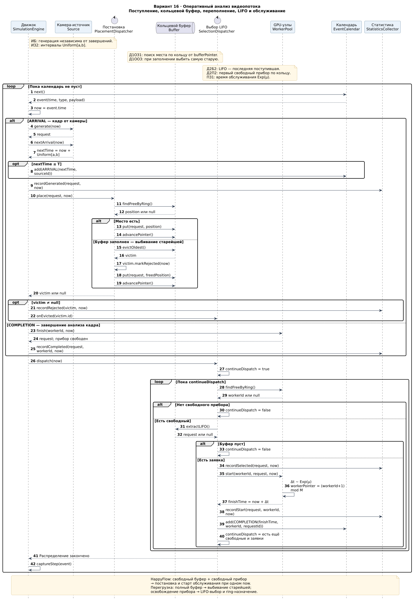
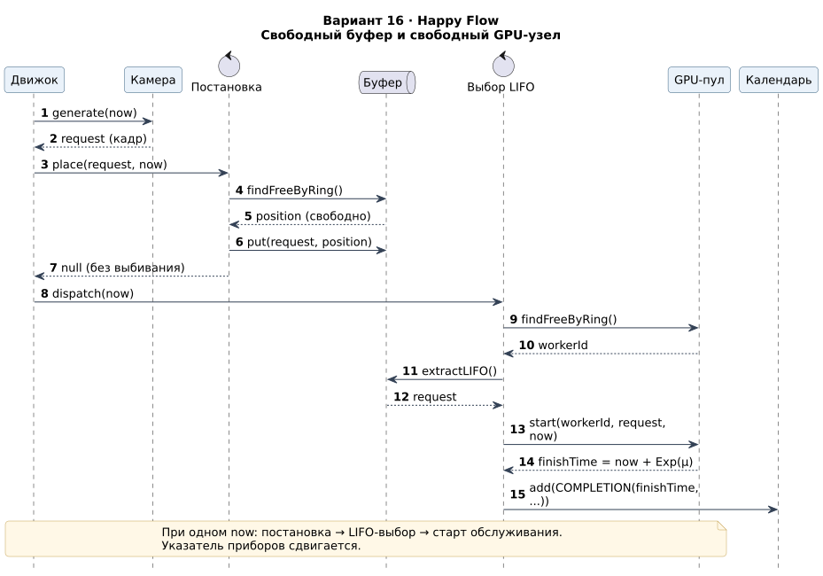
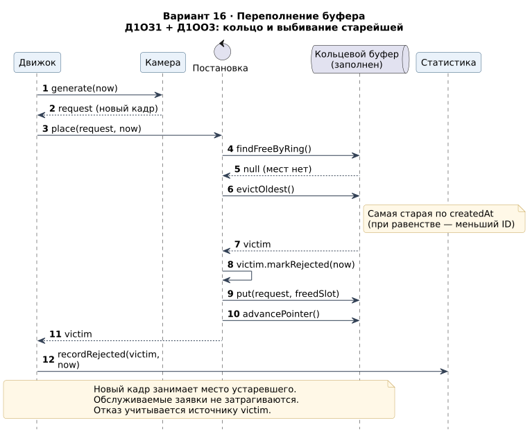
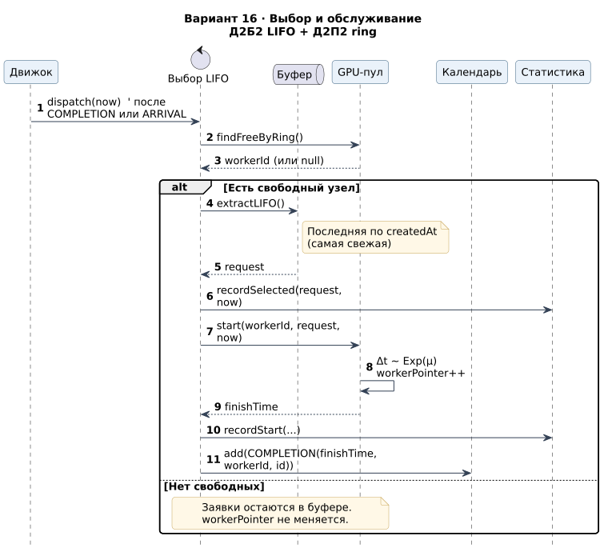
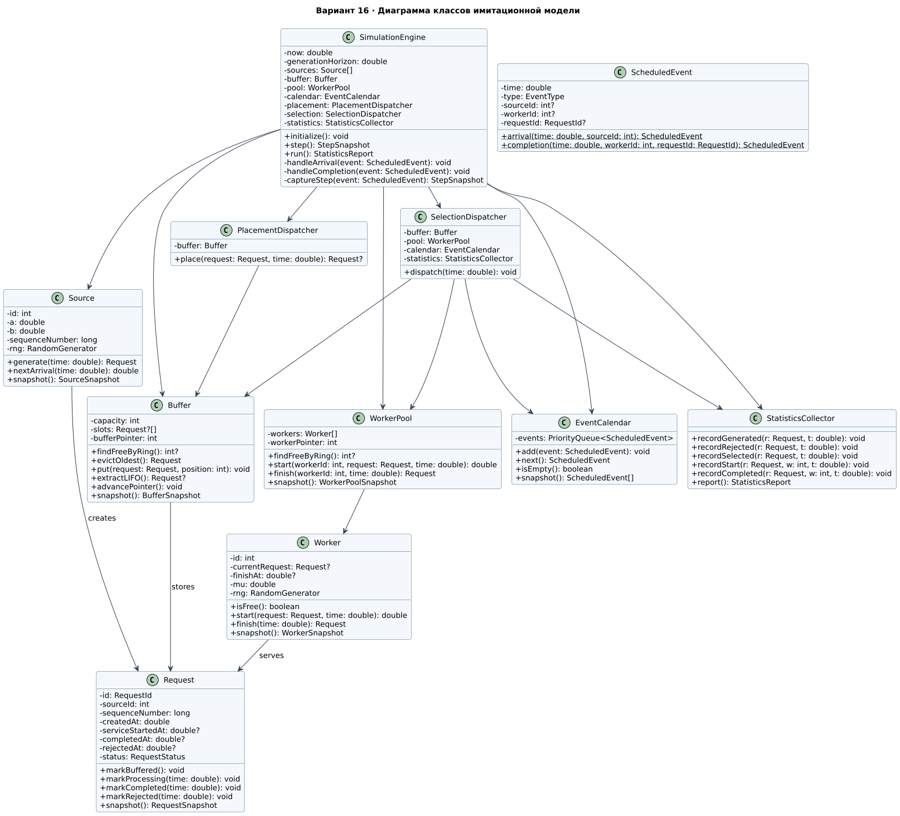
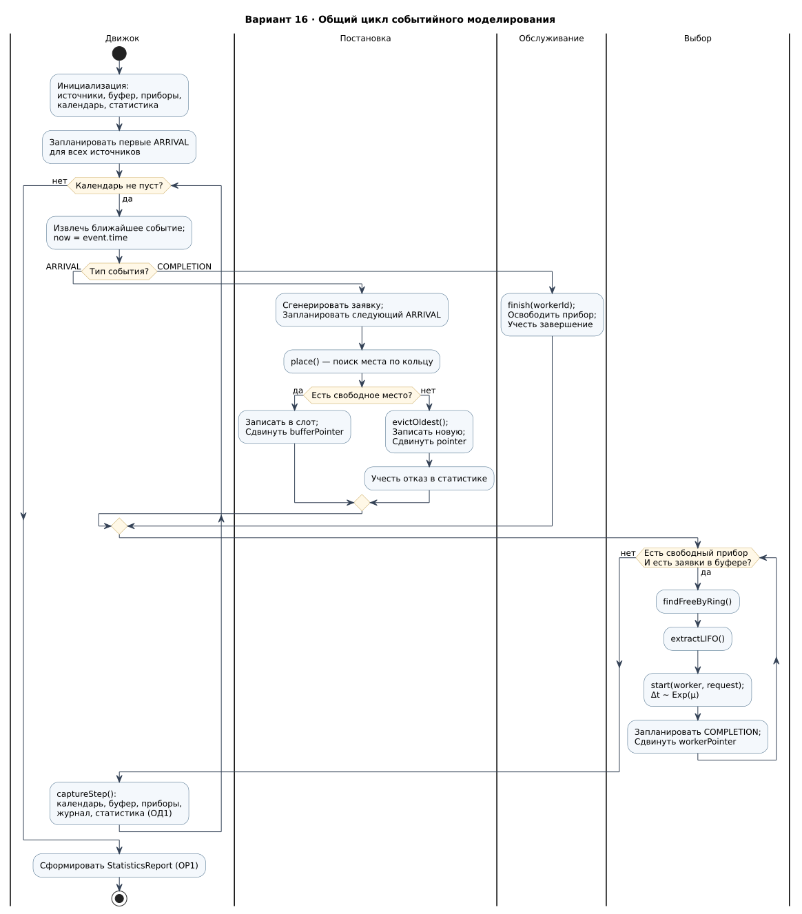
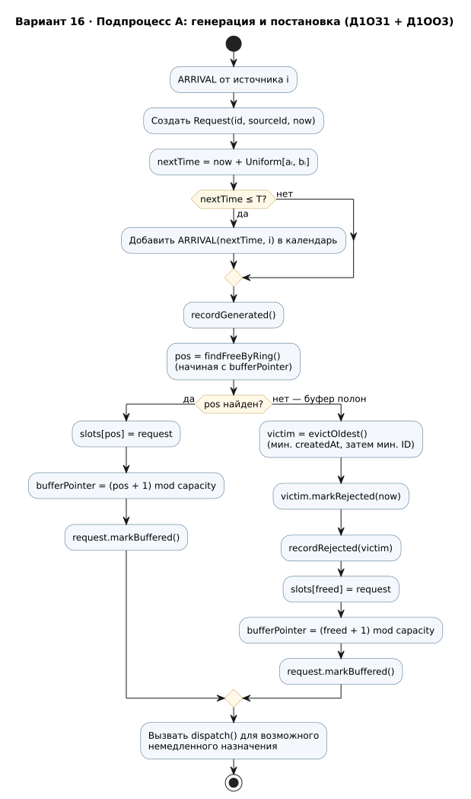
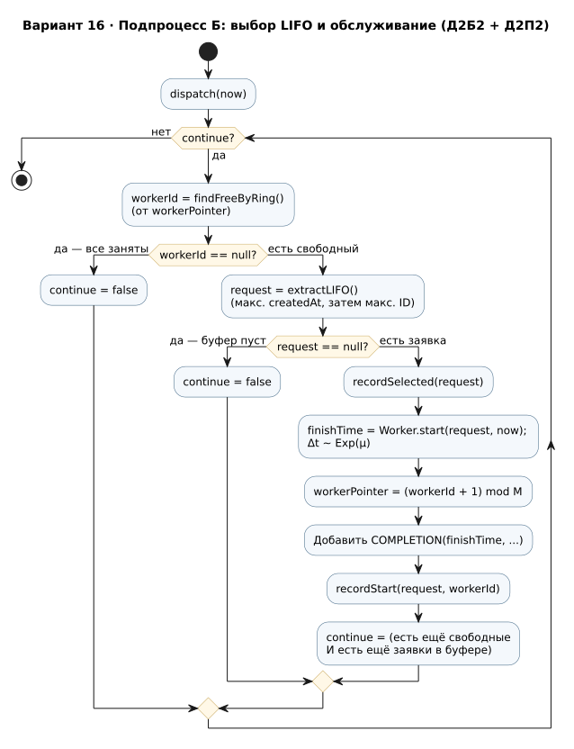

# Система оперативного анализа видеопотока — вариант 16

Камеры видеонаблюдения непрерывно формируют кадры, которые поступают на GPU-вычислительные узлы для автоматического анализа. Если все узлы заняты, новые задания временно размещаются в кольцевом буфере ожидания.

Особенность системы: актуальность кадра уменьшается со временем. Поэтому при переполнении буфера вытесняется самый старый ожидающий кадр, а при освобождении узла выбирается наиболее свежая заявка (LIFO). Выбор свободного узла выполняется по кольцу.

## Элементы модели

| Элемент СМО | Бизнес-сущность |
|---|---|
| Источник | Камера видеонаблюдения |
| Заявка | Задание на анализ одного кадра |
| Буфер | Кольцевой буфер ожидающих кадров |
| Прибор | GPU-вычислительный узел |
| Диспетчер постановки | Приёмщик видеопотока (запись по кольцу, выбивание старейшей) |
| Диспетчер выбора | Планировщик обработки (LIFO + round-robin узлов) |
| Отказ | Потеря устаревшего кадра при полном буфере |

## Формула варианта

**ИБ ИЗ2 ПЗ1 Д1ОЗ1 Д1ОО3 Д2П2 Д2Б2 ОР1 ОД1**

| Код | Правило модели |
|---|---|
| ИБ | Бесконечный источник: следующий кадр не зависит от завершения предыдущих. |
| ИЗ2 | Интервалы между кадрами равномерно распределены на заданном отрезке [a, b]. |
| ПЗ1 | Время обслуживания имеет экспоненциальное распределение с параметром μ. |
| Д1ОЗ1 | Заполнение буфера «по кольцу»: поиск свободного места начинается с указателя. |
| Д1ОО3 | При полном буфере выбивается самая старая ожидающая заявка. |
| Д2П2 | Первый свободный прибор выбирается по кольцу от текущего указателя. |
| Д2Б2 | LIFO: из буфера выбирается последняя поступившая заявка. |
| ОР1 | Сводная таблица результатов по источникам и приборам. |
| ОД1 | Календарь событий, буфер и текущее состояние системы. |

## Первичные артефакты

### 1. Общая диаграмма последовательности

Поступление кадра, постановка по кольцу, переполнение, ожидание, выбор LIFO, назначение по кольцу и завершение обслуживания.

[Исходник PlantUML](docs/diagrams/sequence/main-flow.puml) · [PNG](docs/diagrams/sequence/main-flow.png)

### 2. Обычная обработка — Happy Flow

Пустой буфер и свободный узел: кадр сразу начинает обслуживание.

[Исходник PlantUML](docs/diagrams/sequence/happy-flow.puml) · [PNG](docs/diagrams/sequence/happy-flow.png)

### 3. Переполнение буфера

Все приборы заняты, буфер заполнен → выбивание самой старой заявки и запись новой.

[Исходник PlantUML](docs/diagrams/sequence/overflow.puml) · [PNG](docs/diagrams/sequence/overflow.png)

### 4. Выбор заявки и обслуживание (LIFO + ring)

Освобождение узла, выбор самой свежей заявки из буфера, назначение следующего прибора по кольцу.

[Исходник PlantUML](docs/diagrams/sequence/selection-service.puml) · [PNG](docs/diagrams/sequence/selection-service.png)

### 5. Диаграмма классов

Классы модели, приватные поля, методы и связи.

[Исходник PlantUML](docs/diagrams/class/class-diagram.puml) · [PNG](docs/diagrams/class/class-diagram.png)

### 6. Блок-схема с дорожками

Общий цикл событийного моделирования, обработка поступления и завершения, пошаговый режим и сбор статистики.

[Исходник PlantUML](docs/diagrams/flowchart/system-flow.puml) · [PNG](docs/diagrams/flowchart/system-flow.png)

### 7. Генерация и постановка кадра

Подпроцесс А: поиск места по кольцу, выбивание старейшей заявки при переполнении.

[Исходник PlantUML](docs/diagrams/flowchart/arrival-placement.puml) · [PNG](docs/diagrams/flowchart/arrival-placement.png)

### 8. Выбор заявки и обслуживание

Подпроцесс Б: LIFO-выбор из буфера, кольцевой выбор свободного прибора.

[Исходник PlantUML](docs/diagrams/flowchart/selection-service.puml) · [PNG](docs/diagrams/flowchart/selection-service.png)

## Описание алгоритма

[Правила обработки, календарь событий, статистика и контрольный сценарий](docs/model.md).